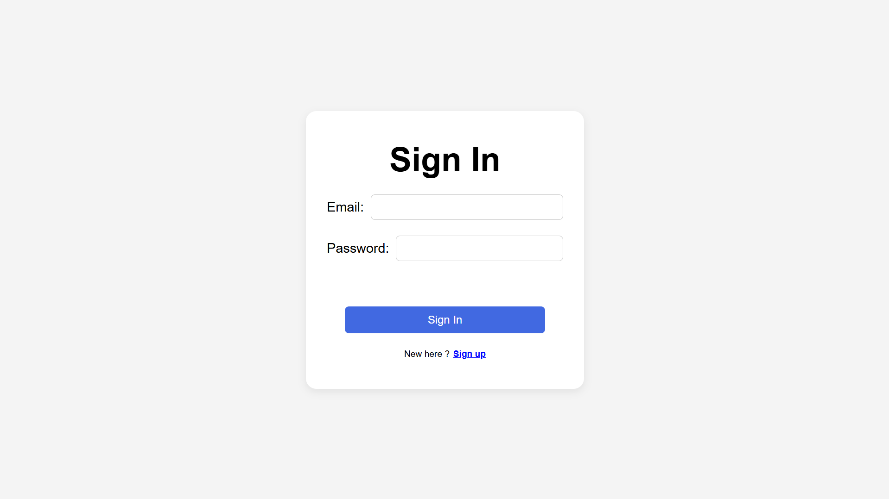
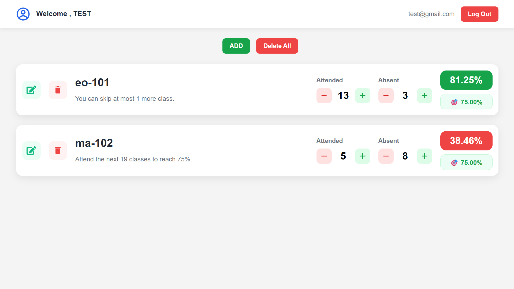
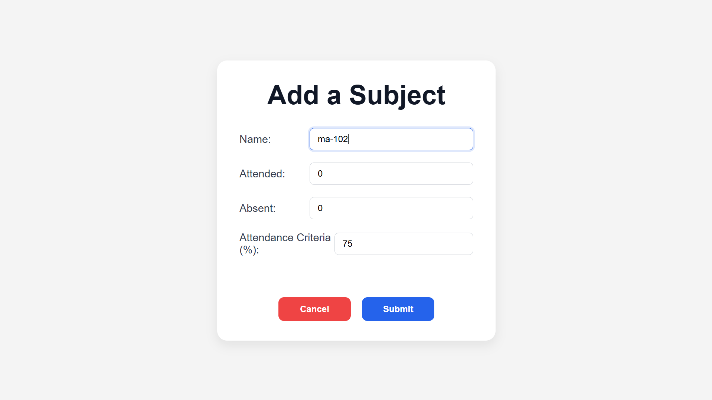
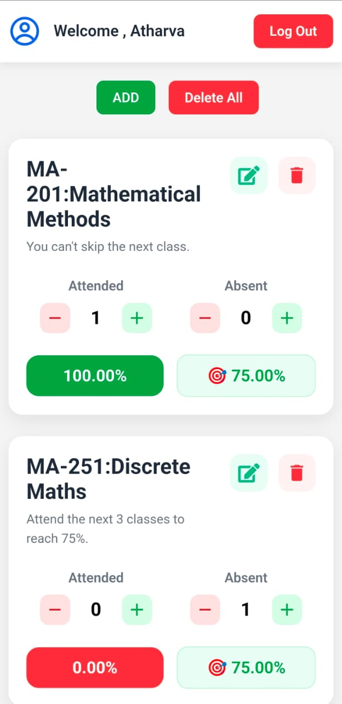

# Attendance Tracker

A full-stack MERN application that helps students track attendance across multiple subjects, calculate attendance percentages, and determine how many classes they can safely skip or need to attend to meet subject-wise attendance requirements.

**Live Demo:** https://attendance-tracker-app-jade.vercel.app/

---

## Features

### Authentication
- Secure user registration and login
- Password hashing using **bcrypt**
- JWT-based authentication
- Protected backend routes
- User-specific data access

### Attendance Management
- Add, edit, and delete subjects
- Delete all subjects with a single click
- Track attended and missed classes
- Set individual attendance criteria for each subject
- Automatic attendance percentage calculation

### Attendance Recommendation
- Calculates the minimum number of classes required to reach the target attendance if below the criteria.
- Calculates how many classes can be skipped while maintaining the required attendance if above the criteria.

### User Experience
- Responsive design for desktop, tablet, and mobile
- Smooth navigation without page reloads
- Loading indicators during API requests
- Disabled buttons while requests are processing
- Immediate UI updates after every operation
- Clean and minimal interface

### Security
- Password hashing with bcrypt
- JWT authentication
- Authorization middleware
- Environment variables for sensitive credentials
- Secure MongoDB Atlas connection
- CORS configuration

---

# Tech Stack

## Frontend
- React.js (Vite)
- React Router
- CSS3
- Fetch API

## Backend
- Node.js
- Express.js

## Database
- MongoDB Atlas
- Mongoose

## Authentication
- JWT
- bcrypt

## Deployment
- Frontend: Vercel
- Backend: Render
- Database: MongoDB Atlas

---

# Screenshots

## Login

<p align="center">
  
</p>

## Dashboard

<p align="center">
  
</p>

## Add Subject

<p align="center">
  
</p>

## Mobile View

<p align="center">
  
</p>


---

# Installation

## Clone the repository

```bash
git clone https://github.com/atharvaKudale25/attendanceTrackerApp.git
```

Move into the project folder.

```bash
cd attendanceTrackerApp
```

---

## Backend Setup

```bash
cd backend
npm install
```

Create a `.env` file.

```env
PORT=3000
MONGODB_URI=your_mongodb_connection_string
JWT_SECRET=your_secret_key
CLIENT_URL=http://localhost:5173
```

Start the backend.

```bash
npm start
```

---

## Frontend Setup

Open another terminal.

```bash
cd frontend
npm install
```

Create a `.env` file.

```env
VITE_baseUrl=http://localhost:3000/
```

Run the frontend.

```bash
npm run dev
```

---

# API Overview

## Authentication

| Method | Endpoint | Description |
|---------|----------|-------------|
| POST | `/signup` | Register a new user |
| POST | `/` | Login user |

## Subjects

| Method | Endpoint | Description |
|---------|----------|-------------|
| GET | `/list` | Get all subjects |
| POST | `/add` | Add subject |
| PUT | `/edit/:id` | Edit subject |
| DELETE | `/delete/:id` | Delete subject |
| DELETE | `/deleteAll` | Delete all subjects |

---

# Attendance Formula

```
Attendance % = (Attended / (Attended + Absent)) × 100
```

The application automatically recalculates attendance after every update.

---

# Attendance Recommendation Logic

If the current attendance is **below** the target percentage:

- Calculate the minimum number of consecutive classes required to reach the target.

Example:

```
Current: 68%
Target: 75%

Result:
Attend the next 19 classes.
```

If the current attendance is **above** the target percentage:

- Calculate how many future classes can be skipped while remaining above the target.

Example:

```
Current: 86%
Target: 75%

Result:
You can skip the next 5 classes.
```

---

# Error Handling

The application handles various edge cases, including:

- Duplicate email registration
- Duplicate subject names
- Invalid login credentials
- Unauthorized requests
- Missing JWT token
- Invalid MongoDB ObjectIds
- Empty form fields
- Invalid attendance values
- Network failures
- Server errors

---

# What I Learned

Through this project, I gained practical experience with:

- Full-stack MERN development
- REST API design
- JWT authentication
- Password hashing using bcrypt
- MongoDB and Mongoose
- CRUD operations
- React Router
- React Hooks
- State management
- Secure backend development
- API integration
- Deployment using Vercel, Render, and MongoDB Atlas
- Responsive UI development
- Error handling and edge-case management

---

# Future Improvements

- Forgot Password functionality
- Email verification
- Attendance history and analytics
- Calendar view
- Dark mode
- Import/Export attendance data
- Charts and graphs

---

# Author

**Atharva Kudale**

If you found this project useful, feel free to ⭐ the repository.
